# Unified Visual Architecture — Implementation Roadmap

Status：**Proposed / Phase 0 review package**。Authority：[RFC index](docs/rfc/unified-visual-architecture/README.md)、[Open Decisions](docs/rfc/unified-visual-architecture/OPEN-DECISIONS.md)、[Test Matrix](docs/rfc/unified-visual-architecture/TEST-MATRIX.md)。本次只完成Phase0，不授權Phase1–7。Current code基線為 `7fb9b73442401fc32a7034888deaf49303e582a6` / 0.20.0。

後續Agent先確認新HEAD差異與批准紀錄；已批准架構不重新發散探索；缺失的ownership/ordering/publicbehavior不能猜。每PR附before/after fixture、sourceSHA、實測命令、flag狀態、rollback步驟與publicformat差異。以下為likelyfiles，不代表Phase0已新增這些核心模組。

## Dependency Graph / PR Order

```mermaid
flowchart LR
  P0[0A RFC baseline] --> Gate[Architecture approval]
  Gate --> P1A[1A schema identity]
  P1A --> P1C[1C commit coordinator]
  P1C --> P1B[1B adapters and tools]
  P1B --> P2A[2A annotations layers]
  P2A --> P2B[2B coords tools history]
  P2B --> P2C[2C shared render]
  P2C --> P3A[3A viewer factory]
  P3A --> P3B[3B sync host lifecycle]
  P3B --> P3C[3C multi viewport validation]
  P3C --> P4A[4A graph document]
  P4A --> P4B[4B graph annotation anchoring]
  P4B --> P5A[5A module v2]
  P5A --> P5B[5B CAS bindings]
  P5B --> P5C[5C refresh recovery]
  P5C --> P6A[6A workspace migration]
  P6A --> P6B[6B bundle v2]
  P6B --> P6C[6C graph separation]
  P6C --> P7A[7A security perf faults]
  P7A --> P7B[7B host acceptance release]
```

PR IDs為追蹤識別，不代表字母順序可忽略依賴。Phase1先1A→1C→1B，避免tools在durability未成立前對user宣稱saved。每PR可再按檔案規模拆不改語義的小PR，但不能略gate或把schema/無測量範圍留實作者猜。

## Phase 0 — Baseline / RFC

Objectives：確認最新main、sourceaudit、設計可驗收契約、舊資料mapping、ADR與reviewgate。Prerequisites：repository access、cleanbranch、safe tempstores。Files：本Roadmap、docs/rfc/unified-visual-architecture全部、`tests/uva-characterization.test.js`。Public interfaces：無production變更。Required tests：npm/docs/release/Python/browserbaseline、兩characterizationcases、researchbenchmark。Acceptance：8RFC/8ADR、40cases、trace/risk/OD、結果不誇大、core零diff。Rollback：revertdocs/testcommit，原資料未動。Dependencies：無。Main risks：把manifest當功能證據、把FakeHost當live、漏掉新main。

| PR | Deliverable / checkable completion | Exit / review evidence |
| --- | --- | --- |
| PR-0A | 本套audit/RFC/ADR/mapping/trace/roadmap/characterization/baseline | docs/releasechecks過、tests真實結果列明、workingtreelimited、停ArchitectureApproval |

## Phase 1 — Document Foundation

Objectives：獨立identity、單一documentauthority、non-destructivestore與legacyadapter foundation。Prerequisites：OD-01/ADR001/007/008批准，8RFC一貫性審查。Files：`src/documents/{schema,service,store,references}.js`、`src/persistence/{coordinator,journal}.js`、`src/compat/legacy-canvas.js`、server.js、storage.js（只adapterintegration）。Public interfaces：document/1、typedRefs、commandexpectedRevision/idempotency、explicitdocread/create（flagged）。Required tests：UVA-01/03/24/27/28/31/32/33。Acceptance：graphkind可建schema但尚不交付GraphUI；newdoc無assetrequirement、falseACK不可發生、legacywrites一authority。Rollback：關newwriteflag；側寫store保留；舊資料source不變。Main risks：雙authority、fsync缺失、IDaliascollision。

| PR | Scope / public contract | Required completion / rollback boundary |
| --- | --- | --- |
| PR-1A | strictdocument/scene/ref schemas、UUIDgrammar、legacysetregistry、read-onlyshadowmapper | duplicate/missingIDcases、oneowner/invariants、sourceunchanged、completefieldinventory；無productioncutover |
| PR-1C | stagedimmutablegeneration、intentjournal、onewriterlock、fixedsnapshotreads、commandledger | UVA31kill每stage、UVA32samekeymismatch/concurrentdocs、UVA33ENOSPC/secondwriter；durableACK只在fsyncpointer後；可退flag仍讀source |
| PR-1B | server composition接DocumentService、legacydefaultsetread/writeadapter、newdocumentread/create toolsflagged | 舊55tools/schema/URIgolden維持；sameasset多doc不混；legacyresultoutput不冒newkind；disabletools不刪sidewrites |

## Phase 2 — Visual Engine Extraction

Objectives：雙domain共同Layer/Interaction/Rendercontract、coordinate/history可驗。Prerequisites：Phase1exit；OD-02/03、ADR002/004批准。Files：canvas-state.js、scene-catalog.js、assessment.js、mark-render.js、scene/objects.js、scene/canvas-render.js、`src/visual/{annotation-contract,layer-contract,coordinates,hit-test,render-plan}.js`。Public interfaces：annotation/layer commands、Anchor/RenderPlan/1、legacy/unifiedprofiles。Required tests：UVA-05–12/34/36（objectanchor完整UI可至Phase4，但purecontracts此處需test）。Acceptance：metadata守恆、sameauthorpolicy、legacyprofile渲染不變、矩陣inverse/tolerance、committedundo安全。Rollback：sharedrenderflag off；newanchors未開就不寫不可讀state。Risks：Evidence欄位遺失、opacity/stacking、undo繞lock、inkgeometrydrift。

| PR | Scope / public contract | Required completion / rollback boundary |
| --- | --- | --- |
| PR-2A | annotation/layercontracts+domainadapters、fieldpreservation、typedLayer.content | richmarks逐欄hash、empty/opacity0/locked保留；user/assistant/module權限現有cases全過 |
| PR-2B | purecoordpipeline/anchortypes、hitregions、commands+inversehistory、eraser/resizeoperation | fixedseedroundtrip/invalidframe、wholemarkeraser與lock、undo-conflict/redo、nohistorycontentloss；尚未多instanceUI |
| PR-2C | commonRenderPlan與server/browser/SVGadapters、legacyprofileshadowcomparison | UVA10/11/34＋measuredserverbudget，nocrossaudiencecacheleak、no arbitraryHTML/SVG，核准後optin |

## Phase 3 — Multi-Viewport Infrastructure

Objectives：拆singleton、DocumentStore共享內容、每viewport獨立camera/tool/selection、Hostrecovery。Prerequisites：Phase2parityexit、ADR003、OD-04transport選擇。Files：public/visual-surface.html、workbench.js、newpublic/visual/*、surface/store/service/layout/mcp-tools/widget-source、serverresourceassembly。Public interfaces：surface/2、PanelBinding/ViewportRecord、documents_get_changes、resultenvelope/1。Required tests：UVA-04/13–18/26/32/35/37/40(fake)。Acceptance：same-doc2views/multidocs、兩widgetOCC、latecallback不錯panel、close不丟data、mobilelayout、量測budget核准。Rollback：單vieweradapter；newdocuments可read/export，無強制降級。Risks：globalDOMselector、keyboard/pointers互搶、stalerender、pollcost。

| PR | Scope / public contract | Required completion / rollback boundary |
| --- | --- | --- |
| PR-3A | Viewerfactory/ViewportController/Panelbinding、SurfaceLayoutController extraction；先image兩instances | global#surface dependency清除、dispose/ResizeObserver/gesturecancel、focusrouting；existingUI同fixture保持 |
| PR-3B | docstore subscriptions、pollreconcile、hostdedup/chunkmissingmeta、widgetrestore+draftpolicy | UVA18/26/32/35 runtimecases，samecommand失ACK可查，noautocreationonreload |
| PR-3C | 1/2/5viewers、多profile/rotation/stress與performance trace | UVA13–18/37數據、heap/listenercycles、核定新workloadbudgets；未核准不能exitPhase3 |

## Phase 4 — Independent Graph

Objectives：Graphdoc不需PNG，保留既有math並取得完整sharedannotationtools。Prerequisites：Phase3exit、OD-02anchors批准。Files：builtin-modules/graph/index/manifest、scene/objects.js（只boundedcontextintegration）、documents/service、visualviewer/inspector、surfacepanelregistry。Public interfaces：create/open/read/exportgraphdoc、explicitframe targeting、anchorpolicy。Required tests：UVA-02/05/06/09/11/12/14–17/34。Acceptance：3graphs+image、多view同graph、freehand/pen/highlighter/eraser/resize/layers/undo/zoom/persistence都驗，不以獨立window顯示作exit。Rollback：disablecreate，existinggraphreadonly+editablearchive。Risks：重寫sampler、fakeimageidentity、worldanchor誤解。

| PR | Scope / public contract | Required completion / rollback boundary |
| --- | --- | --- |
| PR-4A | graphkind/solidbackground、trustedGraphViewer sharedfactory、plotcontextadapter | assetwrites=0、existingparser/sampler/labeltests全過、2Graph互不污染、legacycanvasGraph照常 |
| PR-4B | graphsharedtoolbar、explicitdoc/world/function-xanchor、invalidbadge/reanchor/detach | 完整UVA05/06/09/12與LLMrender/readroundtrip；resize/axesrange/camera區分；無copyengine |

## Phase 5 — CAS / Module Integration

Objectives：modulev2target/permissions/ABI、stableCASbindings、usereditconflict、asyncsafety。Prerequisites：Phase4exit、OD-05/06與ADR005/006/008批准。Files：modules/manifest/router/mcp-tools/permissions/runtimes/packages/selftest/jobs、cas/notebooks/bridge/client、builtinCAS、surface/refresh與publiccalculator。Public interfaces：module/2/panel/2/optionalWASM2、cas-notebook/2、bindingrecord/commands；v1stable。Required tests：UVA-19–21/27–32。Acceptance：9API範例可MCPintegrationexecute、grants不自動擴大、CASpostscene原子、useredit不覆蓋、asyncleasevalidated。Rollback：v2execution/autorefreshoff，publicstoredobjects仍render；nb/v2archive保留。Risks：oldgrant讀所有doc、CASmodel雙authority、跨storepartialcommit。

| PR | Scope / public contract | Required completion / rollback boundary |
| --- | --- | --- |
| PR-5A | v2strictmanifest/targetcontext/grants、v1imageadapter、ABIversion/Storediff | v1signedbytes不改、packageselftests、crossdocdenial、capneededintersectgrants；v1noGraphfakeimg |
| PR-5B | typedCASbinding＋source/targetsignatures、coordinatorlinktransaction、manualeditpause | UVA19/20/31；detach/overwrite/fork具preview+expectedrev；adoptionowner限制、noclobber |
| PR-5C | recomputeattempt/envhash、multitargetpartialrefresh、removed/unavailable、cancel/revocation | UVA21/28/32；lateeffects0、offline不判刪除、afterfault可恢復、每項結果可追 |

## Phase 6 — Workspace / Bundle Migration

Objectives：referenceworkspace、v1→v2sidewrite、editablebundle2、graphseparation。Prerequisites：Phase5exit、OD-06/ADR007/008批准；完整backup可restore至新tempvolume。Files：workspace/storage/bundle/zip/surfacebundleextras、`src/migrations/*`、`src/compat/legacy-bundle.js`、newpreviewUI。Public interfaces：workspace/2、bundle/2、plan/commitmigration與graphseparation、Move/Copy/Link/Embed/Detach。Required tests：UVA-07/12/22–27/29–33/36。Acceptance：每舊格式mapping可replay、wholefieldhash/count/refs、source原bytes不改、realdata操作必plan、rollback保newdata。Rollback：pointer或backupvolume，newwrites先v2archive，不rasterdowngrade。Risks：錯setcasref、layer split、sameState只比marks、importID撞localexisting。

| PR | Scope / public contract | Required completion / rollback boundary |
| --- | --- | --- |
| PR-6A | workspace/2refitems+legacyworkspaceadapter、performatmigrationplanner/registry/report | UVA22/24/25、fullleafinventory、previewhash+OCC、copy-on-write；archivelegacyundo而非誤套新rev |
| PR-6B | bundle/2export/import+v1reader、newIDtwo-passmapping、surface/nb/interactionextras | UVA07/23/25/27/30/31/36；refs/counts/hash/postreloadverify；externalrefunresolved；rollbackarchive驗 |
| PR-6C | graphseparationpreview+選ink/objects/anchor，5ops、incomingref/CAS/evidenceimpact | UVA12/22/24/25；overlap不自動歸屬、locked拒Move、closure完整、undo保原資料與歷史 |

## Phase 7 — Hardening / Release

Objectives：故障、安全、效能與真Host驗收，版本/文件/rollout可操作。Prerequisites：Phase6exit；全部OD批准並核定support期限、測量budgets；實測Host帳號/平台可用。Files：tests/uva-security/recovery/perf、CIoptionalbenchjob、docs/COMPATIBILITY/DEPLOYMENT/TOOLS/RELEASE、Docker/Compose（若必要）、version/URIaliases。Public interfaces：凍結supportedformat/API/ABI版本，noadditionalarchitecture。Required tests：全部UVA01–40，既有全suite、Python、docs/release、newvolumeCompose+backuprestore。Acceptance：0knownP0/P1、realWeb/Mobile逐平台record、securitynopermissionleak、固定runnerbudgetpass、stagedrelease無forcedmigration。Rollback：旗標+原volume備份、newarchive、read-onlyrecovery；tagrelease需既有maintainer流程，不自動發布。Risks：把fakehost當真、測不完整就release、downgrade丟newgraph。

| PR | Scope / public contract | Required completion / rollback boundary |
| --- | --- | --- |
| PR-7A | faultinjection/zip/securityreferencefuzz、fixedrunnerbenchmark、container/backuprehearsal | UVA28–37全部已執行、limits與dataintegrity不退讓、productionruntime與architectures記錄、noignoredskips |
| PR-7B | 真HostWeb/iOS/Android/MCP/CSP驗收、supportmatrix、docs/releases/versionedURIs | UVA38–40逐項evidence；新formats/downgrade說明；maintainer批准release，未驗平台不得labelTested |

## Architecture Approval Gate

Phase0完成後停止核心功能工作。Review需核實OD-01/02/03/04/05/06推薦、所有ADR status、migration/fullfields、40casegate、單writerdurability與Host未知。批准最小單位可為Phase1 foundation，但需記明NotApproved範圍；未有批准不建立任何Phase1productionmodule、不改dataformat。
