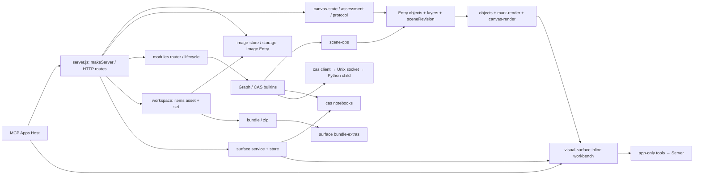

# Architecture Audit — Current Implementation

固定基線 `7fb9b73442401fc32a7034888deaf49303e582a6` / `0.20.0`。本頁全部標為 CURRENT，除非明列 Proposed、Unknown 或觀察限制。函數行號與 imports 的完整索引見 [source-index](evidence/source-index.json)，測試名稱見 [test-index](evidence/test-index.json)。這是 source/dataflow audit，加上 BASELINE 所列測試；不是每個 UI 分支的動態覆蓋證明。

## 現行 Dependency Map

存在 source dependency cycle：`canvas-state → image/transform, scene-catalog, assessment`；`scene-ops → canvas-state.moduleLayer`；`protocol → scene-ops, canvas-state`；`storage → marks-file → scene-ops`。Entry 的開放結構成為跨 subsystem 的資料匯合處；模組不直接持有前端 Viewer。runtime caller 將 entry 注入 renderer 與 storage，沒有正式 Document aggregate。

## Subsystem Responsibility / State / Consumer Matrix

每列同時列出責任、擁有狀態、識別與持久格式、API、內外依賴、tests、限制及遷移影響。Risk 為本次重構風險，不是已利用漏洞。

| Subsystem / code + functions | Responsibilities / owned state / identity / persistence | API、upstream → downstream / dependencies | Existing tests / limitation / migration impact / risk |
| --- | --- | --- | --- |
| MCP/HTTP：[server.js](../../../server.js) `makeServer`, `canvasPayload`, `presentPair`, `presentWorkspace`, `authorized`, `handleOAuth` | 工具註冊、resource、payload budgets、驗證與 HTTP；sessions/uploads/registrations 是 process state；視覺識別以 imageId/set/workspaceKey；資料保存委派 stores | Host → tools → image/marks/scene/modules/surface/workspace；`registerAppTool`、MCP SDK、`fitResult` | `mcp-http`, `http-security`, `image-mcp`, `modules-mcp`, `oauth`, `result-budget`, `upload`；大型 composition root，工具間交易不統一；新 Document payload 與舊 URI 都需 adapter；High |
| Image：[src/image-store.js](../../../src/image-store.js) `registerImage`, `imageIdOf`, `getImage`, `entrySharp`, `prune` | 原始 bytes、EXIF 校正 working bytes、cache；`img:` + SHA256 前 16 hex；same bytes 重用同 Entry；TTL/byte/count eviction | intake/download/storage → Entry → 全部 canvas APIs；Sharp、URL 驗證 | `storage`, `image-tools`, `http-security`；content identity 同時充當預設 mutable canvas identity；解開 asset/doc，不變更 img ID；High |
| Canvas：[src/canvas-state.js](../../../src/canvas-state.js) `applyCanvasChanges`, `storeUserMarks`, `editCanvas`, `snapshotCanvas`, `moduleLayer`, `canvasLayers`, `setKeyOf`, `pairLinks` | Entry.marks Map、layers array、pairLinks、rejections、userEdits；mark ID、L<n> 與 object ID 只在 set 內唯一；無所有內容共用 monotonic rev | server/app user → validation → mutation → storage/protocol/render；assessment、transform | `canvas-state`, `layer-edit`, `layer-rename-regression`, `pair-view`, `claims-mcp`；user 只能移動自己 marks，AI 不可覆蓋 user marks；snapshot 只覆蓋 marks/layers；保留 provenance 與權限；High |
| Annotation protocol：[src/protocol.js](../../../src/protocol.js) `canvasDocument`, `protocolMark`, `marksFromDocument`；[src/interaction-protocol.js](../../../src/interaction-protocol.js) `buildAnnotationEvent`, `formatAnnotationChatMessage` | visual/2 文件；interaction schemaVersion 0.2-draft；explicit intent/quote、stroke timing、focus/context、arrow semantics；不是同一版本軸 | state → model/export；widget → app validation → chat；gesture-groups、assessment | `protocol`, `interaction-protocol`, `polyline`, `gesture-mcp`；marksFromDocument 未回復全部 claim/style/layer data；interaction 不能當持久 Document；保留原 event + schema discriminator；High |
| Evidence：[src/assessment.js](../../../src/assessment.js) `assessmentInput`, `verificationOf`, `findRejection`, `bringsNewEvidence`；[src/gesture-groups.js](../../../src/gesture-groups.js) `gestureGroups`, `recordGestureDecision` | confidence/evidence/ambiguity/user review 與拒絕歷史；stroke group 是假說而非 merge geometry；groupKey sorted member IDs | Canvas claims/paired links → protocol/LLM/UI；以 image + region 與 observer 比對 | `assessment`, `claims-mcp`, `gesture-groups`, `gesture-mcp`；mark 移位不等於 evidence 重新取得；migrate raw metadata、member refs、user intent，不升級 trust；High |
| Scene：[src/scene/scene-ops.js](../../../src/scene/scene-ops.js) `applySceneOps`, `renderedObjects`, `widgetObjects`, `restoreObjects` | Entry.objects、objectSeq、sceneRevision、deletedObjectBatches（10）；o<n>、provenance/module ownership；public/scratch | module/user → ops → objects.js validation/render → server/widget/export；moduleLayer | `scene-ops`, `modules`, `canvas-render`；200 objects/64 ops/60000 points；locked layer checks、batch rollback；restoreObjects silently skips invalid；新 aggregate 不可沿用 silent drop；High |
| Objects / Graph math：[src/scene/objects.js](../../../src/scene/objects.js) `frameOf`, `sampleFunction`, `renderObject`, `primitivesSvg`；[src/scene/expression.js](../../../src/scene/expression.js) `compileExpression` | trusted object schemas（image/axes-2d/function-plot/shape/info-card）、safe parser、normalized primitives；frame object refs local to Entry；render cache rev + count | scene-ops → parser/renderer → browser/SVG/PNG；axes range 提供 y-up mapping | `expression`, `scene-ops`, `compose`, `canvas-render`；adaptive max 6000 eval、depth 7、base 240，輸出會 round；未有 annotation anchoring model；數學 parser/sampler 沿用；High |
| Render/marks：[src/scene/canvas-render.js](../../../src/scene/canvas-render.js) `canvasRevision`, `canvasReadRequest`, `renderCanvas`；[src/mark-render.js](../../../src/mark-render.js) `markSvg`, `renderVerification`；[src/marks-file.js](../../../src/marks-file.js) `exportMarksSvg`, `parseMarksFile` | public composite、verification crops、layered SVG、hash revision；read snapshot 在 await 前擷取；hidden layers 是讀取參數 | Entry → Sharp/SVG/model/export；objects + marks；preview.js default scratch true 是 model preview 意圖，public renderer default false | `canvas-render`, `marks-file`, `layers-e2e`, `compose`；server/browser 分別寫 mark/primitives drawing；SVG metadata 無 objects；sent user opacity .55 是 UI狀態；抽離共同 render plan，先相容 profile；High |
| Canvas UI：[public/visual-surface.html](../../../public/visual-surface.html) `applyInput`, `applyResult`, `syncCanvas`, `render`, `restackLayers`, `setCam`, `fromPointer`, `pickMark`, `commitMarks` | 單一 #surface/#panel-canvas、globals imageId/ws/cam/selected/mode/past/future/pending；hiddenLayers host widgetState，cards localStorage | Host notification/globals → UI；request tools/call → app tools；ui/message → LLM；inline workbench | `unified-canvas`, `visual-widget`, `finding-list`, `cards-e2e`, `layers-e2e`, `zoom-perf`；部分為 source assertions；沒有多 Viewer owner；replace globals 為 scoped instances；Critical |
| Workbench：[public/workbench.js](../../../public/workbench.js) `canvasPanel`, `renderWB`, `wbApply`, `startDrag`, `renderCalc`, `plotCell` | wb.surface/layout、calc Map、els Map、chain；p:canvas 重用 static DOM；calc 狀態已按 panel ID | surface tools → wb；同 script scope 引用 imageId/request/render；layout pure functions inline | `workbench-e2e`, `surface-open`, `surface-refresh`；launcher 只開 calculator，Graph/Canvas 同體；resize profile 不產生獨立 camera；不能複製全域腳本；Critical |
| Surface：[src/surface/store.js](../../../src/surface/store.js) `createSurfaceStore`；[service.js](../../../src/surface/service.js) `createSurfaceService`；`geometry.js` `applyOp`, `reconcile`, `profileFor` | sf: hash(canvasKey)，panel descriptors + open flag + desktop/tablet/mobile layouts + rev + 30 idem keys；surfaces/sf_*.json | server/workbench → service → store/registry/notebooks；open-panel 不授權 module；core canvas cannot close | `surface`, `surface-open`, `workbench-e2e`；12 panels，Graph maxInstances 1，defaultBinding surface.canvas；close notebook survives；改為 document binding + retained viewport；High |
| Graph：[src/builtin-modules/graph/index.js](../../../src/builtin-modules/graph/index.js) `run`, `fitRange`, `pickAxes`；manifest panels | 無獨立 persistent state；plot capabilities 回 ops；default latest axes；target canvas/canvas-or-new | router ctx.canvas → Graph → trusted scene；blank-canvas `createBlankCanvas` → PNG 隨機 tEXt identity | `modules`, `modules-mcp`, `scene-ops`, `surface`；Graph panel 只 descriptor；functions/points/axes logic 可重用；移 target + Graph document 背景；High |
| CAS：[src/builtin-modules/cas/index.js](../../../src/builtin-modules/cas/index.js) `calculate`, `define`, `recompute`, `plotResult`, `after`；[src/cas/notebooks.js](../../../src/cas/notebooks.js) `createNotebooks` | nb:/cell:/cr:、notebook rev + cell rev、definitions/assumptions/results/idem/links；cas/notebooks/nb_*.json；links `{canvas,object,resultId,expression,domain,status,at}` | router → CAS client / astToGraph → graph.run → scene；after hook separately writes notebook | `cas-module`, `surface-refresh`, `bundle-extras`；after-failed 僅 audit、不回滾 scene；定義改動粗粒度 stale 所有 results；user edited plots 無 conflict guard；High |
| CAS refresh：[src/surface/refresh.js](../../../src/surface/refresh.js) `refreshLinks`, `autoRefresh` | 不擁有來源，依 notebook links 操作；最多 5×20 stale cells、8 canvases | surface/module tools → router CAS plot_result；ensure failure 視為 target missing | `surface-refresh`, `workbench-e2e`；刪圖不重建；temporarily unavailable 與 removed 可混淆；新版應 typed missing/offline、source/target revisions；High |
| CAS process：[src/cas/client.js](../../../src/cas/client.js) `createCasClient`；`cas-service/estampes_cas/` Service._fork/parser.parse/interp/ops/worker.apply_limits | Unix socket framed JSON request、queue/jobs/cancel；每 job fork CPU/AS/wall limits；Python 無持久 notebook | builtin client → socket 0600/peer UID → typed AST → SymPy；network none in Compose | Python 17 tests、`cas-module`；Node timeout 與 worker timeout 分層；SymPy AST 不等同 Graph expression；沿用 isolation/serialization；Medium |
| Module control：[src/modules/manifest.js](../../../src/modules/manifest.js) `validateManifest`；registry/lifecycle/admin/packages | strict module/1, panel/1, package/1、granted perms、states、signed bytes/trust/consent plans；modules registry/lock/packages | MCP Store → lifecycle/admin → registry；package selfTest before activate；no arbitrary manifest JS/CSS/HTML | `modules`, `packages`, `module-authoring`, `surface`；new fields rejected strict schema；v2 explicitly versioned，不改簽名 bytes；High |
| Module execution：[src/modules/router.js](../../../src/modules/router.js) `createRouter`, `canvasContext`；runtimes builtin/declarative/wasm/http；jobs/egress | schemas/grants/limited context、async jobs lifecycle/audit；module-owned object edits；jobs persisted、restart interrupted | execute_module → registry/input validation → runtime → output/scene validation → save → after；egress pinned public https no redirect | `packages`, `modules-mcp`, `astrometry`；async work(false)不比 scene rev；per-cap needed 檢查後 ctx 用 record.granted，需防擴大；scope future execution lease；High |
| Workspace：[src/workspace.js](../../../src/workspace.js) `ensureSet`, `makeFork`, `copySet`, `planTransfer`, `stateOf`, `commitDocs`, `undoChange`, `workspaceDocument` | ws:<hex> items `{id,asset,set,placement}`；setKey img or img#c..；fork Object.create(base)；workspace rev/keys/undo/preview；files workspaces/*.json + image/sets/*.json | tools → resolveRef legacy adapters → canvas sets/storage；link shares sets，copy forks；placement 90° steps independent geometry | `workspace`, `workspace-mcp`；24 items/10 undo/30 keys；preview fingerprint marks/layers/links不含 objects；commit files非跨-store atomic；改 refs，不覆蓋 originals；High |
| Storage：[src/storage.js](../../../src/storage.js) `serializeCanvas`, `restoreCanvas`, `saveCanvas`, `ensureImage`, `saveWorkspaceFile`, `sweepStorage` | optional root；images/hash/source/meta/canvas.json(version1)/sets/marks.svg/history/derived.json；documents/<sha> 是 PDF bytes，非新 Visual Document | all state → queued atomic per-file rename；memory is working state；retain originals | `storage`, `derived-view`, `workspace`, `bundle`；saveCanvas catch logs failure，不能據此宣稱 durable ACK；跨-store無交易；不能混用既有 saveDocument(PDF)；Critical |
| Bundle：[src/bundle.js](../../../src/bundle.js) `exportBundle`, `cleanSet`, `sameState`, `importBundle`；[src/zip.js](../../../src/zip.js) `unzipFiles`；bundle-extras collect/install | bundle/1 hashes/files/assets/sets/workspace + optional surface/notebooks；reuse/copy/import provenance；zip limits 400 entries/400MiB total/200MiB entry | workspace/sets → portable zip → validate → intake/restore/forks/adopt → extras | `bundle`, `bundle-mcp`, `bundle-extras`；sameState未比objects/baseAsObject，cleanSet/restoreObjects可丟未知欄位，opacity<.1不回復；new strict loss report/hash/reference audit；Critical |
| Image pipeline：[src/image/view.js](../../../src/image/view.js) `renderView`, `frameFromView`, `rememberView`；transform `multiply`, `invert`, `mapMark`；geometry `geometryStage` | derived recipes/hash IDs、source/working/native/derived matrices、calibration/registration caches；derived.json；affine/homography + condition guard | process_image/source pixels → ops-extra/quality/geometry/engines；registration `registerPair` RANSAC；measure `calibrate`,`measure`；PDF `renderPdfPage` | `derived-view`, `geometry-tools`, `image-tools`, `engines`, `pdf-page`；derived processing不含 marks/graph，render_canvas才是 composite；rect rotated→polyline；沿用 matrices，禁止 registration 當準確真值；Medium |
| CI/deploy：`.github/workflows/{m0,docs,docker}.yml`、Dockerfile/compose.yaml | Node22 checks + Python3.13、optional PDF/browser；docs-only跑 docs；tag才建 multiarch/Compose；single server owner/storage | Git push/PR → tests；tag → smoke/build/publish；CAS隔離服務 | release/docs scripts + test suite；fake host非ChatGPT；本次不啟 Docker、不碰現有 .estampes-data；Phase7需新 volume rehearsals；Medium |

## 已有 Annotation 能力與缺口

| 能力 | CURRENT 證據與可沿用內容 | Proposed 必要補齊 |
| --- | --- | --- |
| Freehand/Point/Rect/Arrow/Polyline | visual-surface `freehandMark/thin/pathData`、scene-catalog validation、128 points、30/send | 純函數抽離，所有 annotation-capable docs 共用 |
| Pen/Highlighter | penStyle、MARK_PENS、markSvg | 同 render plan 保持筆觸與 metadata |
| Eraser | 沒有 eraser tool；選取 Delete 可刪除 | v1 whole-mark eraser，hit test + lock/ownership；segment eraser Future |
| Selection/Move/Resize | pickMark/shifted；user marks move/restyle、AI marks delete；image object inspector region edit | handles resize marks/frame geometry；不暗中放寬 user/assistant ownership |
| Layers/Opacity/Visibility/Lock | order/lock/opacity persisted；visibility hiddenLayers 是 viewport preference | document visible baseline + viewport hidden override；legacy只映射 override |
| Undo/Redo | local past/future 僅 userMarks、送出後清空；scene delete restore 10 batches；workspace undo 10 | committed command undo/redo、revision conflict，不能把現有描述成全面 undo |
| Zoom/Pan/touch/pen | getScreenCTM inverse；第二指 cancel stroke；viewBox cheap update，full render throttle 140ms | controller per viewport、resize/cancel/pen arbitration |
| 雙向標註 | present_visual→marks；validate_visual_annotations→event→ui/message | document-scoped endpoint、explicit intent、submission idempotency |
| 持久化/匯出/還原 | canvas.json/bundle 保留主要 editable domains；SVG畫 objects | 補足 loss reports、全 metadata、cross refs，不經 raster 中轉 |

## 文件、註解與程式不一致

| ID | 設計意圖/歷史 | 實際 source / consequence |
| --- | --- | --- |
| GAP-01 | ARCHITECTURE「no custom upload UI」 | 0.20.0 `upload_visual_image` 與 visual-surface uploadImage 已存在；本次以程式為準，舊段落未同步 |
| GAP-02 | canvas-state 檔頭「in memory only」 | storage.ensureImage/saveCanvas 已可落盤；註解是早期歷史，不能用來否定持久化 |
| GAP-03 | protocol 檔頭「everything…rebuilt」、SVG「restore canvas」 | marksFromDocument/parseMarksFile僅回 marks與簡化layers，SVG metadata無objects；不能當完整 editable archive |
| GAP-04 | bundle 註解「nothing…flattened…same state」 | sameState 沒比較 objects；clean layers不保留module且opacity .0–.05缺失；graph/cas refs remap只image；不是完整性證明 |
| GAP-05 | scene-ops「all or nothing」 | in-memory batch確有 rollback；不是 saveCanvas+notebook after+surface 的 durable transaction |
| GAP-06 | SURFACES panel kind graph/defaultBinding | workbench.canvasPanel搬動同一 DOM，renderBar只列calculator；0.19.5 Changelog明說無第二Graph viewport，並不矛盾但 descriptor不能作功能證明 |
| GAP-07 | COMPATIBILITY other hosts Not tested | 0.20.0 Changelog新增 Claude transport/OAuth/size工作；fake/MCP tests不能推論 live Claude 或ChatGPT已驗收 |

## 本次調查邊界

未讀取使用者 `.estampes-data`，沒有以真實資料嘗試 import/migration；基線全部使用測試 temp stores。未發送 chat/email、未發布 release。工具 URI/metadata 由本地 source/SDK contract 與既有測試核實；沒有真實 ChatGPT Web/Mobile host session trace，CSP/host delivery acceptance 留 Phase7。Proposed API、schemas與路徑位於 RFC，不是 CURRENT。Open Decision 見 OD；Future Extension 不列為現有能力。
