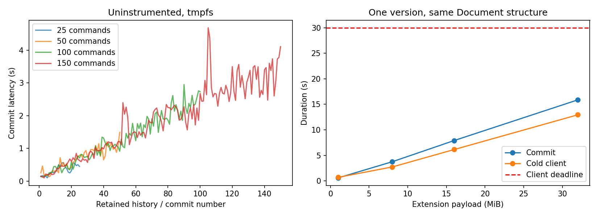

# PR-1D Performance Investigation and G2 Failure Preservation

2026-11-04 (Asia/Taipei). Investigation only. **PR-1D ENGINEERING EXIT BLOCKED. PRODUCTION NOT QUALIFIED.**

Completion classification: **PERFORMANCE ROOT CAUSE PARTIALLY IDENTIFIED**.
G2 classification: **C — UNRESOLVED INTERMITTENT** pending the bounded results below.
No production optimization, schema/format/ACK/GC eligibility change or timeout increase is implemented.

## Baseline and authority

APPROVED: the supplied handoff defines investigation scope; the user's separate instruction
「完成後push」authorizes pushing this independent branch. CURRENT source describes actual
behavior; normative lifecycle/architecture gates define acceptance; measurements are OBSERVED,
recommendations remain PROPOSED. Historical green tests do not override unresolved native failures.

Initial supplied workspace was clean on `work` at `7fb9b73442401fc32a7034888deaf49303e582a6`.
This difference was reported before switching. Fetched
`origin/codex/pr1d-frozen-lifecycle-qualification` and verified exact full HEAD
`616c73c6c4571cd9ebf9eea9e60e21882428b612`; created
`investigate/pr1d-performance-and-g2-evidence` directly at that commit. Verified
`29d097833688ddb649a88cb2a09f22ba5fadda8e` is an ancestor, and its diff through
acceptance/adjudication/qualification to the exact baseline adds only documentation,
evidence and diagnostic harnesses. The production source, original test assertions,
reports and historical evidence remain unchanged. Only the existing lifecycle fixture
gets an opt-in teardown support hook. No historical branch was merged or rebased.

[Baseline commands](https://github.com/Curium-3391/Estampes/blob/d9aaa49f27d195ed53baeb12e95e434f1a7b10b0/docs/rfc/unified-visual-architecture/evidence/pr1d-performance-investigation/baseline.log) and
[pre-edit source/test/all-tracked-file SHA-256](https://github.com/Curium-3391/Estampes/blob/d9aaa49f27d195ed53baeb12e95e434f1a7b10b0/docs/rfc/unified-visual-architecture/evidence/pr1d-performance-investigation/baseline-sha256.json)
fix the inputs. The final manifest verifies all baseline bytes and explicitly names
the one authorized fixture modification. Initial matrix runs precede per-run harness
input manifests; their production/test input is the sealed baseline plus the described
fixture hook. Later runs also retain input-sha256.json. No missing historical profiler
input hash is presented as an independently recorded measurement.

Required qualification/acceptance/adjudication/hardening/trust reports, lifecycle,
final architecture gate and test matrix were read against actual source. The frozen
MATRIX, history-100/200, reader-size, maintenance-drain, G2 raw logs, runs and manifest
were inspected. Actual original entrypoints are frozen `checkpoint.mjs`,
`reader-size-preflight.mjs`, `drain.mjs`, the acceptance `benchmark.mjs` and the unchanged
`tests/persistence-state-machine.test.js` before-rename case. Original ext4 data retain
their 171-ACK wall-budget stop and 67,076,892-byte cold timeout; this runner cannot
re-adjudicate those exact native Stores, which are not present here.

## Environment, budgets and methodology

Linux managed runner, UID/GID 1000, Node 22.23.4 (explicit executable; default Node 24
unused), real `/usr/bin/flock`, 8 GiB cgroup memory and 2 CPU quota. Checkout is overlayfs,
private owned 0700 scratch is tmpfs. No approved native ext4/XFS volume is available.
No privileged mount, native-platform spoof, fsync bypass or production activation.

[Budgets](../../../scripts/pr1d-investigation/BUDGET.md) were committed before
scaled work: serial history 25/50/100, conditional 150, 900 s/run; document payload
1/8/16/32 MiB with conditional near-64 boundary, 180 s/run; 1.5 GiB per-process and
3 GiB tree RSS; memory/free-space/allocation/log floors; original 30 s client timeout.
No 200 or 1,000 commands. Cold means a fresh JS worker/cache, with kernel page cache
intact. Document variants use one identical structure and an extension ASCII string;
payload MiB differs slightly from full stored/command JSON size. No active readers,
backup or maintenance in these isolated cost probes.

Paired plain/profile runs are serial, one observation each. Inspector samples CPU at
10 ms and retained heap allocation sites at 1 MiB. External opt-in loader wraps validation
entrypoints without editing source bytes; method/builtin/FD counters call original methods.
Existing coordinator disjoint phases are retained per commit, including all commits beyond
its 64-row diagnostic ring. Focused phase probes add wall/user/system CPU, memory, leaf I/O,
JSON/schema/hash counts around explicit stages. Inclusive method timers overlap and cannot
be summed. The phase switch for CURRENT is `current.before-write`, so setup/drift checking
just before it remains in the candidate bucket; use original phase timings for exact
coordinator boundaries. OS /proc HWM/RSS and cgroup observations enforce resource caps.
Read bytes count logical I/O, not physical disk traffic. Heap sampling estimates retained
sampled allocations, not transient peak/cumulative allocation or every schema clone.

Direct cold coordinator recovery holds a real lease and is bounded at 60 s; it is distinct
from the client deadline. It publishes a recovery epoch. The subsequent cold client opens
that successor Store; these are separately reported operations, not identical repetitions.

## Cost model and results

[Execution cost/invariant map](https://github.com/Curium-3391/Estampes/blob/d9aaa49f27d195ed53baeb12e95e434f1a7b10b0/docs/rfc/unified-visual-architecture/evidence/pr1d-performance-investigation/COST-MODEL.md)
maps admission, Ledger, schema/closure, Full/Delta, canonical encoding/hash, staging,
fsync, candidate/history verification, CURRENT publication, post-publication and ACK;
and lease, physical recovery, CURRENT/root closure, journal/claims, Ledger/history,
cache/pin initialization, recovery epoch and ready. It links each to measured counters
and explicitly identifies unresolved substage allocation/CPU attribution.

Plain timings below are observations, not acceptance thresholds. All eight history runs
and eight document-size runs exit 0 and verify every admitted version plus exact ACK replay.

| Workload | Commit p50 / p95 / max (s) | Commit total (s) | Cold client (s) | Warm allocated bytes |
| --- | --- | ---: | ---: | ---: |
| history-25-plain | 0.310 / 0.552 / 0.564 | 8.550 | 1.362 | 3252224 |
| history-50-plain | 0.732 / 1.154 / 1.490 | 34.308 | 2.170 | 8826880 |
| history-100-plain | 1.235 / 2.614 / 2.951 | 129.052 | 4.756 | 27316224 |
| history-150-plain | 1.948 / 3.563 / 4.684 | 281.013 | 7.096 | 52146176 |
| document-1-plain | 0.587 / 0.587 / 0.587 | 0.587 | 0.696 | 1187840 |
| document-8-plain | 3.752 / 3.752 / 3.752 | 3.752 | 2.728 | 8527872 |
| document-16-plain | 7.902 / 7.902 / 7.902 | 7.902 | 6.138 | 16916480 |
| document-32-plain | 15.873 / 15.873 / 15.873 | 15.873 | 12.947 | 33693696 |

For one-command document probes the three latency statistics are the same single sample.
150 admission is recorded in history-150-admission.json; 200/1,000 remain NOT RUN.
Near-64 MiB is NOT RUN: 32 MiB profile peak process HWM 804,236 KiB (785.4 MiB)
exceeds the frozen 768 MiB admission bound, despite cold client 13.143 s. No near-boundary
failure is claimed from this narrower denial.

Profile/plain total-commit ratios for history 25/50/100/150 are 1.436/1.115/1.226/1.094.
Document ratios for 1/8/16/32 MiB are 0.919/1.032/0.918/1.011. Ratios below one demonstrate
single-pair run-order/noise confounding, not negative profiler overhead. We do not use
profiled timing as uninstrumented throughput or claim a causal overhead constant.
Full phase totals, direct recovery, syscall/hash/JSON/schema counts and CPU/memory files
are in [RESULTS](https://github.com/Curium-3391/Estampes/blob/d9aaa49f27d195ed53baeb12e95e434f1a7b10b0/docs/rfc/unified-visual-architecture/evidence/pr1d-performance-investigation/RESULTS.md) and summary.json.

Memory evidence: 16 MiB sampled retained allocation is about 33.0 MiB, with ~16 MiB
at filesystem.js JSON.parse and another ~16 MiB at validation.js jsonSchema canonical
round-trip. At 32 MiB it is about 32.0–36.0 MiB, mostly the domain JSON transform; the
oversized record is not retained in the record cache. These retained samples do not
explain the entire transient RSS. The profiled 32 MiB cold open ends with heapUsed
457,901,224 bytes and external 48,797,817 bytes; after exact replay the worker reaches
804,236 KiB HWM. Warm commit HWM is 702,272 KiB. A single "startup RSS" must not silently
include replay. Plain 32 MiB worker commit HWM is 731,024 KiB, cold client HWM 576,568 KiB.
Heap/external are operation-end samples, not interval maxima. No memory leak is inferred.
In warm-worker CPU samples, visit/addString/encode contribute about 82% (8 MiB) and
89% (32 MiB) of sampled non-idle intervals; bootstrap/profiler overhead is included.

## What the evidence establishes

OBSERVED P1: content revalidation and physical metadata work dominate the small-Document
history workload. Candidate verification plus CURRENT and post-publication phases dominate
plain timing. Publication/ACK phases include whole dependency-set rehashes. At commit 100,
there are three `verifyObservations` calls, 48,284 lstat calls, 9,074 FD stats, 6,838 FD reads,
1,118 FD full reads and 27,192 SHA update calls covering 5,966,484 bytes in the profiled run.
Lstat consumes 1.452 s inclusive, FD stats 0.267 s, and SHA update itself 0.016 s of its
2.816 s operation. These nested metrics are not additive. The three full boundary passes
consume 1.236 s inclusive; their digest/metadata children overlap with lstat figures.
Hashing the small bytes is much cheaper than obtaining and rechecking physical identity.
CPU profiles rank native lstat/fstat/geteuid/read operations prominently; V8 idle samples
are waiting samples, not CPU consumption. This is tmpfs evidence, not a native fsync ranking.

OBSERVED retained-history work is not simply repeated full delta reconstruction. At 100,
100 version reconstructions, 99 delta applications, 5,050 version hits and 5,050 registry
hits coexist with 348,350 logical metadata-path traversals, about 1.24 MiB proof metadata
and no proof evictions. Counters for logical proof visits and actual filesystem calls
measure different operations. The logical path traversal count grows much faster than
unique content verification. Historical roots/catalog/ACK membership still need validation;
the current proof representation repeatedly visits shared dependency references.

OBSERVED P2: repeated full-value JSON byte/structure guards, canonical encoding and schema
transforms dominate the extension-string workload. At 8 MiB, a profiled content commit takes
3.665 s inside the coordinator: assertJson 2.522 s inclusive, canonicalJson 1.668 s inclusive,
schema parse 1.753 s inclusive and SHA updates 0.102 s. The categories overlap. Canonical
output totals 100,748,288 bytes (~12 payload copies of encoding work); hash update volume
134,330,139 bytes (~16 payloads). Cold-client coordinator open takes 2.898 s, with guard
1.999 s, canonical 1.197 s, schema 1.396 s and hash update 0.076 s. CPU samples independently
rank validation.js visit/addString/encode above the SHA primitive. These observations do not
mean every guard can safely be removed: several validate different wire/stored/domain values.

There is a measured cache threshold effect. One-version direct cold recovery reconstructs
once at 16 MiB, but three times at 32 MiB; recordHits becomes zero and recordCacheBytes zero.
The same content commit reconstructs twice at 32 MiB. CURRENT source rejects records larger
than the existing 24 MiB VerificationCache/VersionReadSession record budgets. This explains
additional decode/guard work above that threshold; it is intentional bounded-memory behavior,
not proof that a larger cache is safe. The two matrices do not isolate every parse from
allocation/GC, and extension-string results do not establish geometry-rich Document scaling.

At 100 plain commits, phase totals are 23.401 s build/preflight, 8.039 s stage/prepare,
56.656 s candidate/history, 19.310 s CURRENT and 21.493 s post-publication. The last three
account for ~75.6% of transaction time. Across 25/50/100 plain histories, total commit time
8.550/34.308/129.052 s grows by 4.01x then 3.76x when N doubles. Cumulative path visits grow
7.39x then 7.67x; this counted logical work is distinct from actual rehashes/metadata calls.
150 extends the curve rather than certifying a complexity class. A fitted growth trend over
this bounded range is evidence of superlinear cumulative work, not proof of an asymptotic
engine class or a projection that 1,000 commands will fit a budget.

UNKNOWN: exact native filesystem latency, device/flush behavior, source of the full
historical ext4/timing difference, and target deployment performance/RSS SLO. We do not
infer one asymptotic class from three timing points. Count ratios and per-commit curves
quantify observed growth only. Current Document bytes, retained historical bytes and
physical dependency count are separate variables; the one-version document matrix isolates
S, the tiny-document history matrix primarily varies N/D. Independent long-history large
Documents, maintenance, readers and backups were not profiled.

## Mandatory work and bounded proposals

NORMATIVE: strict schemas, exact canonical bytes/hashes, complete retained history,
Ledger/membership, physical identity, selected CURRENT, all durability barriers and final
supported integrity checks remain mandatory. A warm cache hit cannot substitute for fresh
content verification in another operation. Distinct candidate, pre-rename and pre-ACK
checks protect different intervals: their repeated work is costly but this investigation
does not establish permission to remove any boundary. Reuse across them crosses a trust
lifetime. Copied Stores cannot inherit original GC inode ownership.

At most three PROPOSED changes, independently reviewable and unimplemented:

| Rank / independent proposal | Expected benefit and supporting limit | Integrity risk / scope / regression requirement |
| --- | --- | --- |
| 1. Reduce repeated ancestry/metadata work within one coherent verification boundary | Commit-100 lstat alone is 1.452/2.816 s inclusive. Halving that measured component gives an optimistic ~26% wall-time saving; it is an upper-bound model, not a demonstrated speedup. Native gain unknown. | Medium/high: retain file FD/path/hash/length checks and all final boundaries; prove any shared directory observation has the same trust lifetime. Private in-memory change only; all ownership/symlink/hardlink/replacement/race tests and native boundaries mandatory. |
| 2. Reuse already validated/encoded large-Document values within one operation | At 8 MiB, assertJson consumes 2.522/3.665 s inclusive in commit and 1.999/2.898 s in cold client coordinator open. Removing one quarter of those scans would model ~17% saving, before cache/allocation costs. Mandatory scans remain; no achieved gain claimed. | Medium/high: schema/value immutability and canonical-byte parity must be proven. No persistent cache or increased cache budget; retained representation must not increase worst-case memory. Strict malformed input, Unicode/byte/depth limits, binding closure and large-document memory controls required. |
| 3. Deduplicate shared history-proof reference traversal within a snapshot operation | Logical visits rise 6,150→348,350 over 25→100. Whole registry lookup timer is only 98 ms of commit-100 (~3.5%); eliminating it entirely bounds that narrow gain. Lower priority than physical checks/large-value guards. | Medium: preserve every logical membership and path dependency, shared invalidation, locator identity and bounded eviction. No reuse across snapshots or final trust boundaries; all historical hash, cache-budget/eviction and corruption tests required. |

For each proposal: keep durable formats/schema/ACK ordering; introduce no persistent
authority; confine reusable results to an explicitly proven in-operation lifetime;
retain bounded eviction and all final checks. Tests must retain historical negative
assertions, canonical byte/hash parity, live FD/path/ctime/inode corruption fencing,
cache eviction/restart, all-version reconstruction and exact Ledger replay. A speedup
requires a separate causal before/after benchmark on the same approved native profile.

## G2 preservation and bounded confirmation

The unchanged original assertion remains at the second gcStep in the before-rename case.
The lifecycle fixture kills/waits for its disposable writer before optional preservation.
The opt-in preload records actual gcStep return, selected envelope/progress, clock/high-water,
runtime reader pins and last completed filesystem stages before diagnostic reads. An unexpected pre-grace or post-grace fixture return, or thrown GC error, writes a failure marker.
The preservation predicate mirrors this fixture's original two assertions, not a general GC SLA. Full selected-state
inspection calls only read APIs, never open/recover/maintenance. It captures selected plans,
moved/unlinking/deleted/pending, physical candidate source/quarantine dev/inode/hash/length,
live/recovery/checkpoint dependencies, backup lists and pins. Reads use an independent
verification observation and cannot establish new authority.

Before teardown removal, ownership/device/realpath checks reject arbitrary paths, symlinks,
hardlinks and oversized scratch. The stopped Store is inventoried/hashed and copied, and copy
bytes are verified. Original inode identities are stored separately; evidence copies are never
opened for GC. Once before/ is sealed, one cold restart plus one same-plan step can run on the
original disposable Store with an overall 60 s cap. Exact subprocess command/exit/signal/stdout/
stderr and after/ snapshot are retained. Inspection failure retains the original without retry.
Default mode makes no transaction or test assertion changes. Independent controls exercise
invalid scratch/aliases, default inertness, immutable before-copy, and one real-plan restart.
The synthetic trigger is explicitly labelled and is not a reproduction of the intermittent.

Four bounded original before-rename cases pass 1/1 each, exit 0, no skips. Every selected
plan has 12 candidates; first return waiting-grace has moved 12/deleted 0, second return
complete has moved 12/deleted 12. No failure marker, preserved real-failure Store or
post-failure retry exists because no unexpected return occurred. This is tmpfs process-crash
confirmation, not native ext4 reacceptance. The independent synthetic control seals actual
before/after Store copies and retry command/exit 0; it validates the preservation path without
claiming a captured intermittent. Historical native failure remains C — UNRESOLVED INTERMITTENT.
No G2 state-machine change or relaxed completion assertion was made.

## Validation, finite next actions and remaining gates

| Check | Observed result |
| --- | --- |
| History and size matrix | 16/16 invocations exit 0; all-version/hash and exact ACK replay assertions pass |
| Focused phase probes | History-25 and Document-8 exit 0; stage CPU/I/O/JSON/schema/hash/memory tables retained |
| Original G2 before-rename case | Four 1/1 pass, exit 0, no skips; fixed maximum then stop |
| Preservation controls | Initial 2/2 pass; final 3/3 pass after adding pre-grace/terminal trigger predicate test |
| Related unchanged regressions | 82/82 pass, exit 0, no skips; before-rename case explicitly excluded here to respect its four-attempt bound |
| Instrumentation parity | Plain/profile probes exit 0, same canonical hash; malformed/accessor input rejection, one Ledger effect, exact retry and payload mismatch preserved |
| Source/history preservation | 1,209 baseline paths checked, 1,208 byte-identical; one allowed fixture hook; src/package/legacy runtime and all original assertion/report/evidence files unchanged |
| Final syntax/docs/release/seal | All exit 0; docs checks 114 Markdown files; exact commands/logs and hashes retained |

The first docs check exited 1 because the report linked manifest.json before the seal had
been generated. That raw failure is retained; final documentation checking occurs after
sealing. No assertion was weakened to obtain a pass. Full unrelated browser/CAS or native
qualification suites are not claimed as rerun by this instrumentation-only assignment.
The old architecture checker has a historical frozen allowlist; instead of widening it,
this branch uses exact baseline manifests, source/history preservation and narrow diff scope.

Focused phase evidence corroborates the main split: the 8 MiB commit spends approximately
790 ms in admission, 1,540 ms build/preflight and 1,659 ms candidate verification, with only
~158 ms in staging/publication/post phases; admission includes strict command/schema and
payload hashing before #publish. At history-25, the final commit's candidate bucket contains
5,683 lstat calls and ~440 ms. These use documented approximate markers and inclusive leaf
timers; actual coordinator phase boundaries remain the primary plain timing measure.

Finite next actions: review the three scoped proposals, implement only separately authorized
ones, then repeat matching plain/profile/native measurements with existing correctness
regressions. Run the preserved original native G2 case once on an approved ext4 volume;
stop at the first failure and classify only from selected progress, protections, grace and
one bounded retry. Do not conduct an unbounded search for green results.

Remaining PR-1D gates stay blocked: 200/1,000 history and revision-1000 checkpoint/recovery/
verified thinning; supported-boundary large-document startup; sustained maintenance drain;
physical ENOSPC; full quota/reader/backup pressure and fixed-runner profile/SLO approval.
Deployment writer UID/code/config isolation, old-binary fencing, real Host/authentication,
cross-Store/binary integration, backup continuation, and VM/block-device/host power loss
remain independent. No PR-1B, Unified Writer activation, main merge or Production Qualified
claim. Historical smaller passing gates remain historical evidence, not new acceptance here.

[Runs/exits/log hashes](https://github.com/Curium-3391/Estampes/blob/d9aaa49f27d195ed53baeb12e95e434f1a7b10b0/docs/rfc/unified-visual-architecture/evidence/pr1d-performance-investigation/runs.jsonl) ·
[Derived full counters/profiles](https://github.com/Curium-3391/Estampes/blob/d9aaa49f27d195ed53baeb12e95e434f1a7b10b0/docs/rfc/unified-visual-architecture/evidence/pr1d-performance-investigation/summary.json) ·
[Final SHA-256 seal](https://github.com/Curium-3391/Estampes/blob/d9aaa49f27d195ed53baeb12e95e434f1a7b10b0/docs/rfc/unified-visual-architecture/evidence/pr1d-performance-investigation/manifest.json) ·
[Reproduction](../../../scripts/pr1d-investigation/README.md).

## Git delivery

Baseline/budget commit `2f8abf3`; opt-in profile harness `4b701b0`; G2 preservation
`7afd9f4`; per-worker/control evidence support `b42faa5`. Final oracle/verification support is `8d4143d`; sealed report/evidence follow as a
separate logical commit on the same investigation branch. Resolve their full IDs with `git log 616c73c6..HEAD`; final response records the
delivered tip, push and clean-tree state. This report does not claim a merge or deployment.
