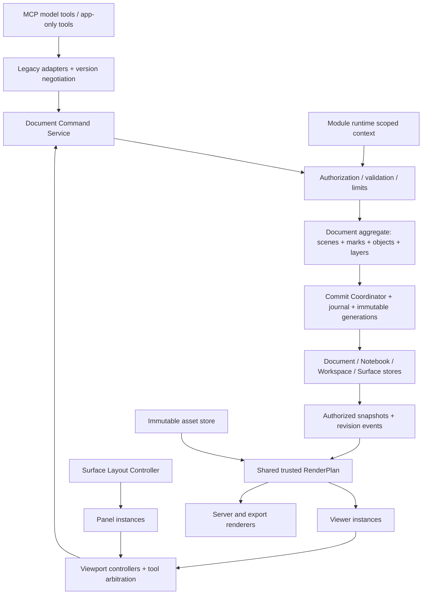

# RFC-001 — Architecture & Invariants

Status：**Proposed Architecture；待 Architecture Approval**。CURRENT 見 [AUDIT](AUDIT.md)，實測見 [BASELINE](BASELINE.md)。Open Decision 見 [OD-01–06](OPEN-DECISIONS.md)；Future Extension 在本頁末尾。

## Problem Statement / Current Architecture

目前 Image Entry 同時代表 immutable pixel asset、default canvas、scene aggregate、render cache；`canvas-or-new` 需生成 PNG；Graph frame reference只在一個Entry內解析。workbench單一Canvas DOM與全域camera使兩個Graph無法獨立互動。mark、scene、notebook、surface、workspace 各有不同版本與提交路徑。現行工具與資料有使用者依賴，必須保留。[AUDIT](AUDIT.md) 每項結論列出 source/function，不以 manifest 或歷史文件作為已實作證據。

## Target Logical Architecture

單 Node process / 單 owner / 單 writer storage。Document aggregate 負責內容一致性，並不包所有 UI、CAS、Workspace：RenderPlan純函數、reference resolver、transaction coordinator、tool adapter各自有界。既有 expression/sampleFunction 不搬入 DocumentStore。

## 正式術語與邊界

| 概念 | 定義、owner、不可承擔的責任 |
| --- | --- |
| Asset | 不可變 bytes + full SHA256 + MIME + origin；AssetStore持有。imageId仍可作legacy alias，不是Document ID。無Scene或Panel lifecycle |
| Document | 可獨立保存/封存/匯出的內容aggregate；doc:<UUID>，type image/graph，owns scenes、共享歷史、跨scene本地bindings；無camera、DOM或module runtime |
| Scene | 唯一Document內的有序內容分區，owns objects/annotations/layers/frames；scene:<UUID>；不可同時隸屬兩份Document |
| Annotation | 保留geometry、authorship、grounding、evidence、verification、intent/group refs的可編輯domain；不是降格後的一般shape |
| Layer | Scene內的順序/opacity/visible/locked政策，包含兩種domain的content refs；視圖隱藏另存viewport |
| Coordinate Frame | 明確space/reference/unit/transform/revision，frame為數學axes或有明確父的local transform；不猜目標 |
| Viewport | 對Document中一個Scene的觀看/互動實例；camera、selection、工具、local overrides、HUD；vp:<UUID>，有persisted preference與runtime分層 |
| Viewer | trusted rendering/interaction component instance，訂閱一個Viewport；DOM/WebGL/SVG/AbortController皆屬runtime；無持久資料ownership |
| Panel | Surface內UI實例，bind一個Viewport或Notebook；closed/minimized≠document刪除；panel:<UUID> |
| Surface | panels + device layouts + per-panel viewport preferences；sf: ID，與Document生命周期分離；不含文件副本 |
| Workspace | placement/reference collection；引用Document+Scene與asset dependencies，copy需另建Document；不內嵌可變副本 |
| Module | 受控capabilities集合、schema/permissions/runtime/package/lifecycle；只回可信operations/data，不回任意DOM |
| Capability | module下versioned operation，宣告input/target/access/output；context只包含此次已授權資料 |
| Render Output | 某snapshot+view policy生成的primitives/PNG/SVG等衍生結果；附revision/hash/mapping，不是source of truth；export raster明確選擇 |

## Alternatives

| 方案 | 權限/ownership | lifecycle/ordering/async | migration/testability | 結論 |
| --- | --- | --- | --- | --- |
| A：Image Entry擴充kind，虛擬imageId，複製Canvas script | 同一state bucket，asset仍兼document | 原有UI singleton與scene rev衝突，Graph仍依image API | 短期低工時，但混合格式與pixels expectation無法靜態區別 | Reject；無法證明無PNG依賴與多viewport隔離 |
| B：Document aggregate + dual domains + explicit references（推薦） | typed IDs、單一scene owner、scoped module context | doc commands serial/OCC，viewer獨立，journal跨store提交 | 需adapter與copy-on-write，分期可shadow comparison；同時保留legacy | Recommended；符合硬約束且可逐PR驗證 |
| C：全域entity graph，共享Scene/Object+CRDT | 每object ACL、共同ownership複雜 | 多writer merge/cascade需要新語義 | reference/undo/migration面過大，單使用者無需求證據 | Future，V1不支援共享可變Scene |

## Architectural Invariants

| ID | 必須成立 | 證明方式 |
| --- | --- | --- |
| INV-01 | Asset ID、Document ID、Scene ID、Viewport ID、Panel ID不可互換；Graph creation零PNG intake | UVA-01/02；typed parsers拒錯ID；spy asset writes |
| INV-02 | Scene、Object、Annotation、Layer只有一個mutable owner；跨doc只typed link/embed/copy | UVA-03/22；no alias Map/object reference |
| INV-03 | panel close/hide/minimize不刪document/notebook；unreferenced doc可列出重開 | UVA-04/15 |
| INV-04 | 所有支援annotations的doc共用commands/interaction/render contract；Graph無另一筆跡格式 | UVA-05/06/12/13 |
| INV-05 | provenance/evidence/review/gesture/intent不在遷移時被猜測、升級或悄悄省略 | UVA-07/23/24/25 |
| INV-06 | camera/selection/tool/async request只在viewport instance；doc commit同步所有訂閱者 | UVA-14/16/17/18 |
| INV-07 | 模組、input、operation、object ownership、layer lock、cross-doc authorization每次都驗證 | UVA-28/29/30 |
| INV-08 | durable ACK後reader只見完整committed generation；retry同key同request只產生一個效果 | UVA-31/32/33 |
| INV-09 | 不靜默覆寫原檔、不自動raster flatten；loss/quarantine必須明示，rollback可檢查 | UVA-23/24/25/26 |
| INV-10 | server/browser/export取同snapshot、RenderPlan、visibility policy；presentation decorations明列 | UVA-10/11/34 |
| INV-11 | persisted anchors有space/reference/inverse/error policy；invalid refs保留失效狀態不跳點 | UVA-08/09/12 |
| INV-12 | legacy callers保留語義、URI與permissions；schema v2不能由v1擴權推得 | UVA-27/28/35 |
| INV-13 | CAS refresh不覆蓋user-edited target、不能因暫時offline判定removed | UVA-19/20/21 |
| INV-14 | 未經真實Host腳本驗收，不稱ChatGPT Web/Mobile相容已通過 | UVA-38/39/40 |

## Data Flow / Ownership / Lifecycle

LLM或user mutation → tool adapter resolves explicit target → authorize target+operation → load committed DocumentSnapshot → validate command/expectedRevision → pure draft apply → refs/layers/limits validate → coordinator commit → snapshot event → DocumentStore reducers → each viewport schedules RenderPlan projection。失敗不改live state，衝突回current revision而不自動重播geometry。tool output重送只hydration，不能重新執行create。

DocumentStore只負責cached authoritative snapshots/subscriptions/pending command status；DocumentService owns domain mutation；CommitCoordinator owns disk durability；ReferenceService resolves links under auth；Renderer doesn't mutate。module的能力輸出由DocumentService採納，module不能拿storage/fs/service handles。

每個scene local owner確定；同doc可有多scene，但V1 image/graph預設一個scene、viewport一次顯示一個scene；doc-wide transactions可以同時改多scene，不能共享scene。跨doc Scene或Object共享改以ReferenceBinding，ownership不轉移。Workspace只放ref，close panel不觸及archive；archive需explicit operation，delete/purge不在本輪release。

## Implementation Boundaries / Non-goals

Proposed檔案責任：`src/documents/{schema,service,store,commands,references}.js`、`src/visual/{annotation-contract,layer-contract,render-plan,coordinates,hit-test}.js`、`src/persistence/{coordinator,journal}.js`、`src/compat/{legacy-canvas,legacy-module,legacy-bundle}.js`、`public/visual/{document-store,viewport-controller,viewer,interaction}.js`；Roadmap逐PR核准，不要求先建立空殼。既有`storage.saveDocument`為PDF，不能重用名稱假裝同domain。

不含任意JS Viewer插件、跨serverlinks、即時多user協作、CRDT、segment eraser、3D/implicit/parametric graph、共享mutable Scene、刪除舊API、默認重寫儲存。Future Extension必須新RFC，不能當為V1未定義行為補空白的理由。

## Phase 0.1 — Review Invariant Refinements

核心方向不變。R-01/R-02由[ANNOTATION-POLICY](ANNOTATION-POLICY.md)細化INV-04/05/07：createdBy/Actor/Owner/Grants分離、Unifieduser可編輯AI/moduleink、legacyroute保舊政策；Evidence/Verification按context保歷史。

R-03細化INV-08/09：[STORAGE-LIFECYCLE](STORAGE-LIFECYCLE.md)是V1必要InternalGC/compaction，logicalhistory不刪；R-04：[EMBED-CONTRACT](EMBED-CONTRACT.md)只有childdocauthority、snapshotclone獨立；R-05：九例經文件專用schema驗證、不是已實作；R-06：[AUTHORITY-CUTOVER](AUTHORITY-CUTOVER.md)明確A0–A7與OSfence，flag無authoritytransaction能力。所有推薦仍需humanapproval，ReviewRemediation不進Phase1。
